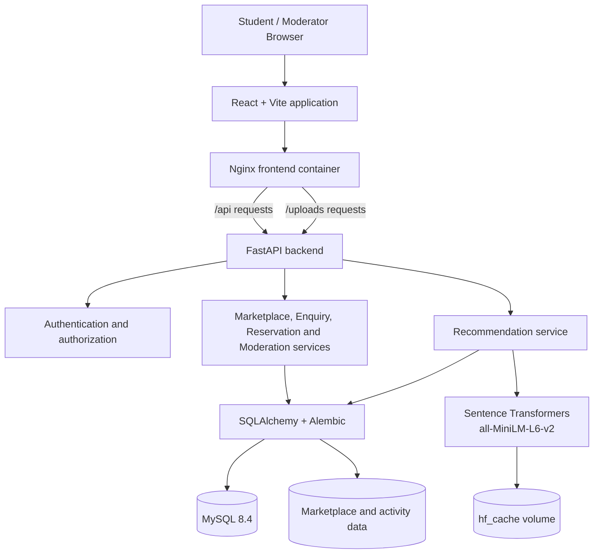

# ReUse Campus

**An AI-assisted student-to-student campus marketplace**

ReUse Campus is a web application for students to list, discover, reserve, and exchange pre-owned campus essentials. It combines marketplace workflows with semantic and activity-aware recommendations, enquiries, reservations, and moderator-led listing review.

## Project links and submission material

| Resource | Location |
|---|---|
| GitHub repository | [https://github.com/Chetan-cs26mt019/reuseCampus](https://github.com/Chetan-cs26mt019/reuseCampus) |
| Figma design | [Open Figma design](https://www.figma.com/design/zqy2T5qgeBk0wWmVGTQlwd/ReUse-Campus-%E2%80%94-Gradient-Marketplace-Redesign?node-id=1-6&t=hMnQNM7S4y2K78jj-0) |
| Figma prototype | [Open interactive prototype](https://www.figma.com/proto/zqy2T5qgeBk0wWmVGTQlwd/ReUse-Campus-%E2%80%94-Gradient-Marketplace-Redesign?node-id=1-6&t=vaHTt5GCdVaZcB6a-1&scaling=min-zoom&content-scaling=fixed&page-id=1%3A4&starting-point-node-id=1%3A6) |
| Architecture and technical report | [`docs/Architecture-Report.pdf`](docs/Architecture-Report.pdf) |
| Entity Relationship Diagram | [`ER_Diagram.pdf`](ER_Diagram.pdf) |
| OpenAPI contract | [`docs/openapi.yaml`](docs/openapi.yaml) |
| GitHub Actions workflow | [`.github/workflows/ci.yml`](.github/workflows/ci.yml) |
| Image attribution | [`backend/uploads/IMAGE_ATTRIBUTION.csv`](backend/uploads/IMAGE_ATTRIBUTION.csv) |
| Main project milestone document | [`Milestone-1.pdf`](Milestone-1.pdf) |

## Main capabilities

- Browse, search, and filter campus listings by category and price.
- Register, sign in, manage a profile, create listings, and upload listing images.
- Save favourites and view personal listing collections.
- Send buyer-to-seller enquiries and exchange messages.
- Request and manage listing reservations.
- Report listings and support moderator decisions, including reversible hiding, permanent removal, dismissal, closure, and action history.
- Explore popular, similar, and personalized recommendations.

## Architecture overview

The application is deployed as three primary Docker Compose services plus a short-lived demo information service:

1. **Frontend:** React and Vite build the browser application. Nginx serves the production static files and reverse-proxies `/api` and `/uploads` requests to the API service.
2. **Backend:** FastAPI exposes REST endpoints for authentication, marketplace listings, enquiries, reservations, moderation, and recommendations. SQLAlchemy handles persistence and Alembic manages schema migrations.
3. **Database:** MySQL 8.4 stores users, listings, categories, images, favourites, reservations, enquiries, moderation records, and recommendation/activity data.
4. **AI recommendation path:** Sentence Transformers (`all-MiniLM-L6-v2`) converts listing text and search intent into embeddings. The API ranks candidates using cosine similarity and activity-derived weights. Embeddings are cached in MySQL; the Hugging Face model cache is stored in the `hf_cache` Docker volume.



### Main backend modules

| Layer | Responsibility |
|---|---|
| `backend/app/api/` | HTTP routes, request handling, dependencies, and response schemas |
| `backend/app/services/` | Business logic for authentication, marketplace, images, enquiries, reservations, moderation, activity, and recommendations |
| `backend/app/models/` | SQLAlchemy entities and database constraints |
| `backend/app/schemas/` | Pydantic request and response validation |
| `backend/alembic/versions/` | Versioned database schema migrations |
| `backend/tests/` | API, service, workflow, and integration tests |

### Data and recommendation flow

- Listing title, description, category, and condition are combined to form listing text.
- The embedding model creates normalized semantic vectors. A source hash and model identifier allow the service to reuse a current cached embedding and invalidate stale listing embeddings when listing text changes.
- Similar-item recommendations compare a listing vector with available listing vectors using cosine similarity.
- Personalized recommendations combine a user's favourites, completed reservations, recent listing views, and recent normalized search terms into a weighted interest profile. The service excludes the user's own listings and already-interacted-with listings from its candidate results.
- Popular recommendations use favourite counts and completed reservation counts, with recency as a tie-breaker.
- New users with no recorded interest signals receive an empty personalized result rather than fabricated preferences.

## Technology stack

| Area | Technology |
|---|---|
| Frontend | React, JavaScript, Vite, CSS, Nginx |
| Backend | Python 3.12, FastAPI, Pydantic |
| Persistence | MySQL 8.4, SQLAlchemy, PyMySQL |
| Schema migrations | Alembic |
| AI / semantic similarity | sentence-transformers `all-MiniLM-L6-v2`, NumPy, cosine similarity |
| Testing and quality | pytest, pytest-cov, Ruff, ESLint, Vite production build |
| Packaging and deployment | Docker, Docker Compose |
| API documentation | OpenAPI 3.1 YAML and FastAPI Swagger UI |

## Run locally with Docker

### Prerequisites

- Docker Engine
- Docker Compose plugin

### Start the application

From the repository root:

```bash
docker compose up --build -d
docker compose ps
```

The Compose setup starts MySQL, the FastAPI API, and the Nginx-served frontend. The API waits for MySQL health, applies Alembic migrations through its entrypoint, and loads repeatable synthetic demo data.

| Service | Local address |
|---|---|
| Frontend | http://localhost:5173 |
| Backend API | http://localhost:8000 |
| Swagger UI | http://localhost:8000/docs |
| OpenAPI JSON | http://localhost:8000/openapi.json |
| Health check | http://localhost:8000/health |

### Environment configuration

Copy `.env.example` to `.env` and set strong local values before using the application beyond a disposable local demo. Compose supports `MYSQL_PASSWORD`, `MYSQL_ROOT_PASSWORD`, and `SECRET_KEY` environment variables. Do not commit a real `.env` file or production secrets.

### Persistent Docker data

- `mysql_data` stores the MySQL database.
- `hf_cache` stores the downloaded Hugging Face model cache.

Avoid `docker compose down -v` unless you intentionally want to delete both persistent volumes and their contents.

### Stop services without deleting data

```bash
docker compose down
```

## Verification snapshot

The following results were recorded during the final Docker-based validation session for this project:

| Check | Recorded result |
|---|---|
| Backend pytest suite | 74 passed, 1 skipped, 0 failed |
| Backend statement coverage | 80.01% (CI threshold: 60%) |
| Ruff | All checks passed |
| Frontend ESLint | Passed with 0 errors |
| Vite production build | Passed |
| Docker API / database / frontend | Reported healthy |
| API health endpoint | `{"status":"healthy","service":"ReUse Campus API"}` |

The skipped test is the MySQL integration test when `TEST_DATABASE_URL` is not configured in the execution environment. The GitHub Actions workflow provisions a separate MySQL test database and sets `TEST_DATABASE_URL` so that this integration test can run in CI.

Re-run backend tests inside the API container:

```bash
docker compose exec api sh -c   "cd /app && python -m pytest --cov=app --cov-report=term-missing --cov-fail-under=60"
```

Ruff is installed in the GitHub Actions job rather than the production API image. To run the same lint check without changing the API image, use a temporary container:

```bash
docker run --rm -v "$PWD/backend:/workspace" -w /workspace \
  python:3.12-slim sh -c "pip install -q ruff && ruff check ."
```

Frontend lint and build can be checked in a temporary Node container:

```bash
docker run --rm -v "$PWD/frontend:/workspace" -w /workspace \
  node:22 sh -c "npm ci && npm run lint && npm run build"
```

## AI feature design and evaluation

The recommendation feature is a local semantic recommendation workflow based on `sentence-transformers/all-MiniLM-L6-v2`. It provides three result modes:

- **Popular:** ranks available listings using favourite and completed-reservation counts, with listing recency as a tie-breaker.
- **Similar:** embeds listing title, description, category, and condition, then ranks other available listings by cosine similarity.
- **For You:** builds a weighted user-interest vector from favourites, completed reservations, listing views, and search history, then ranks eligible listings by cosine similarity.

The repository contains seven recommendation-focused automated tests covering similar listings, missing listings, favourites, new-user behavior, embedding caching, listing-view signals, and search-history signals. These are functional tests, not an offline relevance benchmark. No precision@k, recall@k, NDCG, latency benchmark, or human preference study is claimed in this report because no such measured results are included in the project evidence.

## Security and privacy notes

- Passwords are hashed with Argon2; API access uses signed, expiring bearer tokens.
- Protected routes resolve the current active user through a shared authentication dependency.
- Moderator operations enforce the moderator role in backend service logic and record moderation actions with actor, reason, and timestamp.
- Listing-image uploads verify file signatures and decoded image format, enforce a 5 MB limit and a five-image-per-listing limit, generate server-side filenames, and check listing ownership.
- Database access uses SQLAlchemy sessions; foreign keys, unique constraints, and migrations enforce important data relationships.
- The recommendation flow uses listing/search text and activity signals. The project design does not send passwords, private enquiry messages, or personal identifiers to an external model provider.
- Demo credentials are for local classroom demonstration only and must not be used on an internet-facing deployment.
- Before public production deployment, configure strong secrets, review dependency audit findings, and add production-grade HTTPS, backups, monitoring, and operational controls.

## Demo accounts

The seed data creates synthetic demo accounts and 50 synthetic catalogue listings for local presentation. These credentials are intentionally public and local-demo-only:

| Role | Email / username | Password |
|---|---|---|
| Seller | `demo.seller@reusecampus.test` / `demo_seller` | `DemoSeller2026!` |
| Buyer | `demo.buyer@reusecampus.test` / `demo_buyer` | `DemoBuyer2026!` |
| Moderator | `moderator@reusecampus.test` / `demo_moderator` | `DemoModerator2026!` |

Do not use these credentials on a public deployment.

## Team

| Member ID | Name | GitHub |
|---|---|---|
| CS26MT012 | Tarun Kumar | [cs26mt012](https://github.com/cs26mt012) |
| CS26MT019 | Chetan | [Chetan-cs26mt019](https://github.com/Chetan-cs26mt019) |
| CS26MT020 | Archit Kumar | [ArchitKumar-020](https://github.com/ArchitKumar-020) |

## License and third-party assets

Review `backend/uploads/IMAGE_ATTRIBUTION.csv` for the catalogue image sources and their licence information. Preserve attribution records when redistributing project assets.
